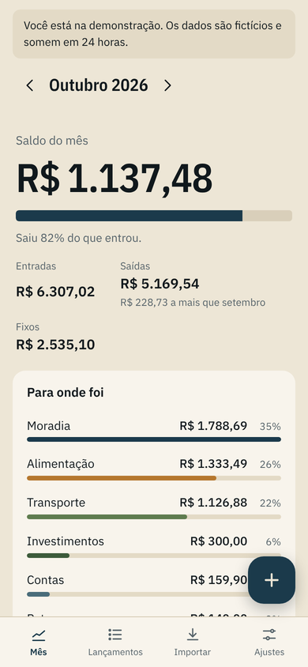
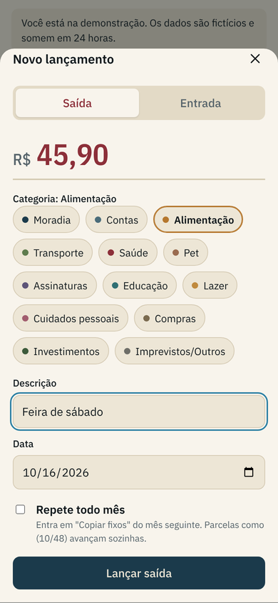

# Saldo

**[Versão em português](README.md)**

A personal finance tracker that runs in the browser and installs on your phone as an app. Log income and expenses in a few taps, see the month's balance and where the money goes. The interface is in Brazilian Portuguese.

It grew out of a real Google Sheets budget I use at home. Saldo imports that spreadsheet, keeps the same categories, and exports back to the same layout.

> **Try it:** [alanfmf.github.io/Financeiro/app](https://alanfmf.github.io/Financeiro/app/) in the browser, or get the Android APK at [alanfmf.github.io/Financeiro](https://alanfmf.github.io/Financeiro/). Click *Abrir a demonstração* for a temporary account with four months of fictitious data.

<p>
  
  
  
</p>

## Features

- AI assistant in the corner: type or speak "spent 45.90 at the market and 120 on gas yesterday" (in Portuguese) and it books both entries in the right categories and dates, each with Edit and Undo. It also answers questions about your spending. Each user connects their own AI in Settings (Claude, ChatGPT or Gemini) with their own API key, which is verified, stored encrypted (AES-256-GCM) and never sent back to the device. The model can only call five server-side tools (book, correct, delete, query, summarize), and the API validates and writes everything scoped to the logged-in user. Without a key it falls back to a rule-based parser.
- Monthly balance front and centre, with a bar showing how much of the income has already been spent and a comparison with last month.
- Fast mobile entry: numeric keypad, category chips, pre-filled date, and a home-screen shortcut straight to the form.
- Recurring items and installments: copy fixed entries to the next month in one tap; `Loan (10/48)` becomes `(11/48)` automatically and the final installment is not copied again.
- Spending by category, six-month history, search and filters.
- CSV import with preview, per-line validation, automatic category creation and duplicate detection; CSV export in the spreadsheet format.
- Android APK built and published by GitHub Actions on every push (Capacitor 8), plus an installable PWA. Automatic dark mode, mobile-first layout.
- Public demo with no real data: each visitor gets a throwaway account deleted after 24 hours.

## Stack

- **API:** Node.js 22, TypeScript, Fastify 5, Zod, JWT, bcrypt, rate limiting.
- **Database:** PostgreSQL 16 with hand-written SQL and versioned migrations. Local development and tests run on PGlite (Postgres compiled to WASM), so nothing needs installing.
- **Frontend:** React 18, TypeScript, Vite, TanStack Query, React Router, vite-plugin-pwa.
- **AI:** bring-your-own-key for Claude (Messages API), ChatGPT (Responses API) and Gemini (generateContent), each behind a thin `fetch` adapter with a shared tool-calling interface; per-user hourly limits.
- **Quality:** Vitest (84 tests, including the sentence parser, the three AI adapters against recorded request/response shapes, and the assistant against a scripted fake AI), GitHub Actions against a real PostgreSQL 16.
- **Hosting:** Vercel (frontend), Render (API), Neon (database), all on free tiers.

## Design decisions

- Money is stored as integer cents, never floats.
- Reports are plain SQL (`sum ... filter`, `generate_series`, `date_trunc`) rather than an ORM.
- A small `Db` interface lets the same code run on PostgreSQL or PGlite.
- Every query is scoped by `user_id`, with tests proving one user cannot read, delete or reuse another user's data.
- Import is idempotent and previewed before anything is written.

## Running locally

```bash
git clone https://github.com/AlanFMF/Financeiro.git
cd Financeiro
npm install
npm run dev   # web on :5173, API on :3333 with an embedded PGlite database
npm test
```

Deployment steps (Neon, Render blueprint in `render.yaml`, Vercel with root `web` and `VITE_API_URL`) are described in the [Portuguese README](README.md#publicando-de-graça).

## License

MIT. Built by [Alan Fabrício de Morais Filho](https://www.linkedin.com/in/alanfmf).
